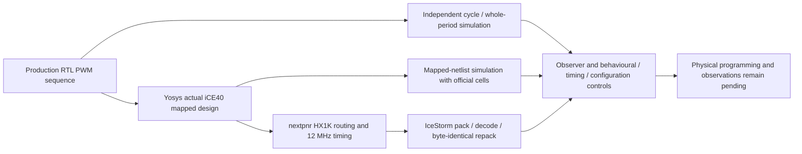

# iCEstick PWM demonstration

**Status: software verification passes; physical deployment is incomplete. No board or programmer was available.** The original goal includes programming a physical FPGA and observing its behavior. A simulated design and a generated bitstream do not satisfy that requirement. **Crucible is beta.**

- [Quick start](#quick-start)
- [How it works](#how-it-works)
- [What runs](#what-runs)
- [Repository layout](#repository-layout)
- [Individual stages](#individual-stages)
- [Results and controls](#results-and-controls)
- [Troubleshooting](#troubleshooting)
- [Reports and limits](#reports-and-limits)
- [Licence](#licence)

This candidate iCEstick design cycles through 0%, 25%, 50%, 75% and 100% PWM duty on red LED D1. Independent RTL and actual mapped-netlist simulation cover the full production sequence. Managed Yosys, nextpnr and IceStorm produce a routed, timing-checked, packed configuration. Behavioral, impossible-timing and configuration-bit controls test the verification guards.

Read the [ten-page software-verification PDF](docs/FPGA_PWM_iCEstick_Software_Verification_Ignytion_A4.pdf) or [editable A4 PowerPoint](docs/FPGA_PWM_iCEstick_Software_Verification_Ignytion_A4.pptx). [Compact results](evidence/summary.json), [candidate board references](evidence/board.json), [official model identity](evidence/models.json) and [document hashes](evidence/documents.sha256.json) are included. Fresh runs regenerate local `build/` and `reports/`; those directories stay outside Git.

## Recorded software results

Measured locally on 1 November 2026:

| Check | Observed result |
|---|---|
| Production RTL and mapped top | 5,243,400 cycles and 5,263,881 comparisons each |
| PWM coverage | All five duty stages, exact endpoint samples, 20,481 whole periods and sequence wrap |
| Core boundary/reset tests | Two parameter configurations; 10,120 cycles and 10,155 comparisons each |
| Final route resources | 47/1,280 logic cells, two I/O, two global buffers; no RAM or PLL |
| Final timing estimate | 191.35 MHz maximum frequency against the 12 MHz target |
| Bitstream | 32,220 bytes; 265 decoded configuration records agree; repacked bytes identical |
| Negative controls | Broken zero-duty endpoint, 1 GHz target and changed configuration bit rejected |
| Physical programming/observations | **Not performed; board/programmer unavailable** |

The frequency is the final nextpnr device-model estimate, not a measured board clock or vendor signoff result. The mapped simulation uses unchanged official iCE40 cell models and zero delays. Decoded configuration matching establishes serialization consistency; post-route logical equivalence and physical behavior remain unverified.

## Target, timing and reset contract

Candidate board: **Lattice iCEstick Evaluation Kit, iCE40HX1K, TQ144**. This is the software build target; it does not imply that the user owns or has purchased a board. The [manufacturer guide](https://www.latticesemi.com/view_document?document_id=50701) describes the nominal 12 MHz oscillator and D1 LED. Its LED table maps D1 to pin 99, and its known-issue note says pin 21 must remain an input. The [official nextpnr example PCF](https://github.com/YosysHQ/nextpnr/blob/main/ice40/examples/blinky/blinky.pcf) independently maps clock to 21 and LED1 to 99. The LED schematic shows active-high drive through a resistor to ground.

| Item | Contract |
|---|---|
| Top ports | `clk` input on pin 21; `led` output on pin 99 |
| PWM period | 256 clock samples |
| Duty sequence | Exactly 0, 64, 128, 192 and 256 high samples per period, then repeat |
| Stage hold | 4,096 PWM periods in the production top |
| Stage transition | Only when the phase wraps to zero |
| Startup | A configuration-initialized counter holds engine reset for seven clock edges |
| Engine reset | State reset is synchronous active high; LED is forced low while reset is asserted |

At a nominal 12 MHz clock, arithmetic predicts a 46.875 kHz carrier, 87.381333 ms per stage and 436.906667 ms per five-stage sequence. These are derived expectations, not measurements. There is no external reset pin. The output is a combinational PWM comparison; physical pulse integrity and transients require measurement. The top has one internal clock domain and an asynchronous LED observation output with no external receiving-clock constraint.

`pwm_demo` supports positive `STEP_PERIODS` values used here: 1, 2 and 4,096. The short core tests exercise the first two. Both full top simulations retain the real 4,096-period production configuration. They do not replace the counter with a faster implementation.

## Quick start

Open a Linux/WSL terminal in this repository root. Crucible is beta. Linux x86-64/WSL and an existing Crucible beta installation. No PDK, extra observer Python packages or physical board is needed for the software stages. The software target is iCEstick / iCE40HX1K / TQ144. Native runtime libraries and network access for initial managed-tool acquisition remain prerequisites.

```sh
igny init
igny workspace sync
igny tool install make --version 4.4.1 --env fpga-demo
igny run --env fpga-demo make setup
igny run --env fpga-demo make check
```

This release is software-verified. No board/programmer was available. Pin/clock/LED/startup behaviour must still be measured on an actual confirmed board; a packed configuration is not physical deployment.

Run the complete experiment after satisfying those prerequisites:

```sh
igny run --env fpga-demo make run
```

Every executable example in this guide goes through Igny. Make delegates to the supplied stage scripts and observers; failed stages stop the workflow. Make 4.4.1 is installed separately from the existing engineering-tool lock. The setup target only checks Python standard-library availability. The check target checks observer imports; it does not qualify a PDK or native-library installation.

## How it works

The production design cycles through all five PWM duty settings with its real stage duration. Independent RTL and mapped simulations check complete periods. Routing uses the actual package pins and a 12 MHz constraint. Packing is checked by decoded configuration comparison and byte-identical repacking; these checks do not substitute for hardware observations.



## What runs

| Component | Pinned version |
|---|---|
| icestorm | 2026.04.03 |
| iverilog | 14.0.0 |
| nextpnr | 0.10.0 |
| yosys | 0.63.0 |

The lock restores those engineering tools; the setup target prepares only project-local observer dependencies where needed. Initial acquisition may require network access. Native Windows/macOS/ARM tool execution and independent clean-machine reproduction are not established by these results.

## Repository layout

```text
.
|-- Makefile             Managed workflow entry points
|-- crucible.toml        Workspace selection
|-- crucible.lock        Engineering-tool identities
|-- rtl/                 Production PWM engine and startup wrapper
|-- constraints/         Actual package pins
|-- tests/               Independent observers and deliberate behavioural fault
|-- scripts/             Build, model provenance, bitstream comparison and verification
|-- docs/                Reviewed PDF and editable PowerPoint
|-- evidence/            Compact reviewed measurement snapshots
`-- build/               Generated local artifacts; ignored by Git
```

## Individual stages

Run these from the same prepared workspace. Stages use earlier outputs; execute them in the listed order when reproducing the flow manually. The run target performs the full ordered workflow.

| Managed command | Work performed |
|---|---|
| `igny run --env fpga-demo make identity` | Record actual tool/model providers |
| `igny run --env fpga-demo make rtl` | Run both core configurations and the full production sequence |
| `igny run --env fpga-demo make synth` | Map production RTL and retain unchanged official models |
| `igny run --env fpga-demo make mapped` | Run the same independent full-top observer against the mapped design |
| `igny run --env fpga-demo make route` | Place/route HX1K/TQ144 at 12 MHz, seed 1 |
| `igny run --env fpga-demo make pack` | Pack, decode, compare all configuration records and repack |
| `igny run --env fpga-demo make negative` | Reject broken zero-duty behaviour, impossible timing and a changed configuration bit |

Inspect or recheck existing results without rebuilding:

```sh
igny run --env fpga-demo make smoke
igny run --env fpga-demo make report
igny run --env fpga-demo make help
```

The smoke target validates existing generated evidence. It is not a new experiment run. The report target prints local summaries and fails if required results are absent. The sed target normalises only public shell inputs to LF; run invokes it automatically.

## Results and controls

Require PWM_SOFTWARE_SIMULATION_SYNTHESIS_ROUTE_TIMING_BITSTREAM_AND_CONTROLS_VERIFIED and retain PHYSICAL_DEPLOYMENT_INCOMPLETE_NO_BOARD_OR_PROGRAMMER. Both full top simulations check 5,243,400 cycles, 5,263,881 comparisons and 20,481 complete periods. The recorded bitstream is 32,220 bytes with 265 matching decoded records. The final nextpnr estimate is 191.35 MHz against 12 MHz; this is not a measured board frequency.

Expected negative failures are handled by the existing runners/observers. Missing tools, compilation failures, timeouts and missing artifacts do not count as successful controls. Changing sources or inputs requires rerunning the affected stages and their dependents. Raw logs and generated runtime/PDK payloads remain local.

## Troubleshooting

| Symptom | Check / next action |
|---|---|
| Wrong workspace or missing tool | Open the terminal in the root containing crucible.toml; use the explicit project environment in this guide and restore the lock. |
| Make is not bound | Repeat the managed Make installation in Quick start. |
| Observer dependency is absent or changed | Repeat the managed setup target; retain the pinned requirements. |
| Native library or PDK is missing | Supply the prerequisites described above. Lock restoration and observer setup do not provision them. |
| Evidence is missing or stale | Run the full workflow or the affected stages in order. Preserve the reported failure instead of editing expected values. |
| Negative control unexpectedly passes | Treat the guard as failed and inspect its artifacts. |

## Reports and limits

Read the [technical report](docs/FPGA_PWM_iCEstick_Software_Verification_Ignytion_A4.pdf) or its [editable PowerPoint](docs/FPGA_PWM_iCEstick_Software_Verification_Ignytion_A4.pptx). The documents record measured results and exclusions; source commands in this README are the current managed workflow.

Physical programming, clock/duty/startup/reset observations and repeated power-cycle acceptance are pending. No programming target is provided. Post-route equivalence, SDF, other boards/corners and vendor signoff remain outside scope.

Review the source/document package locally with:

```sh
igny run --env fpga-demo make preflight
```

This checks the public candidate and document hashes; it does not publish anything or rerun engineering verification.

## Licence

Dependencies retain their upstream licences and credit. This checkout has no project-wide licence grant; the owner must select the intended project licence before presenting it as an open-source release. No upstream endorsement is implied.
